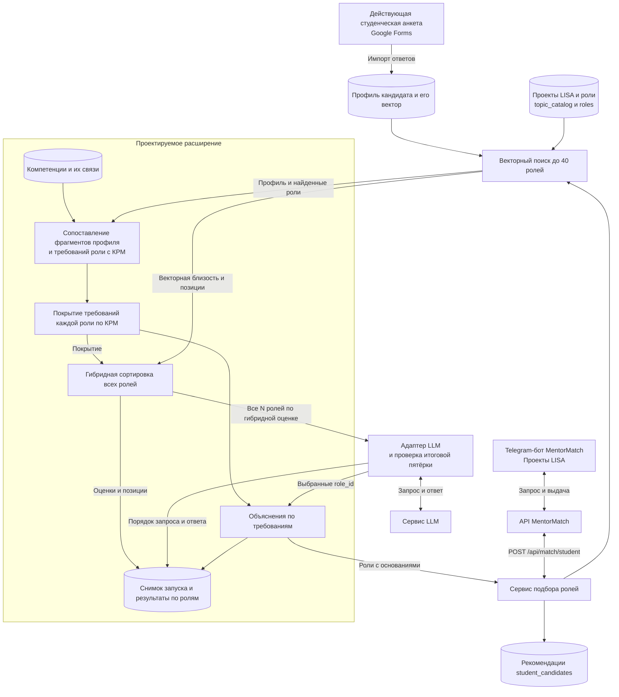
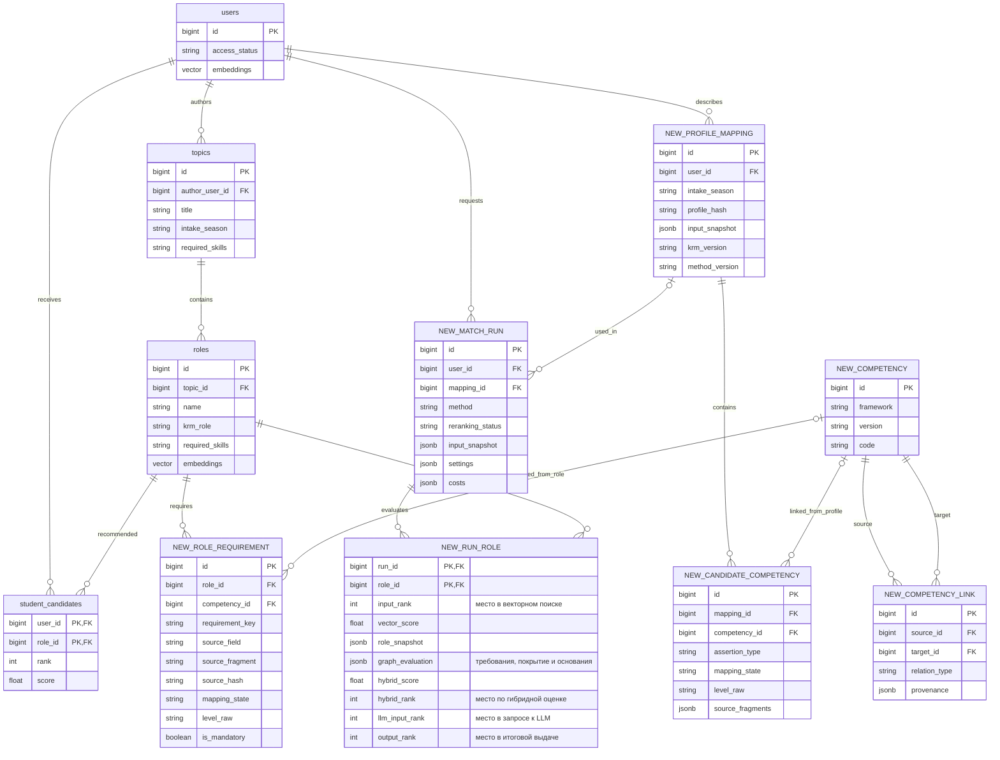
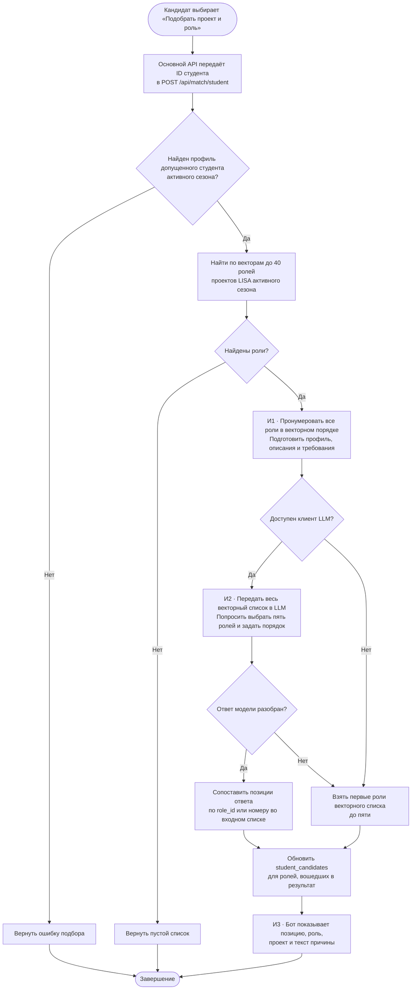
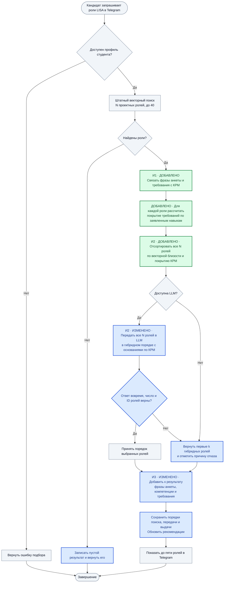
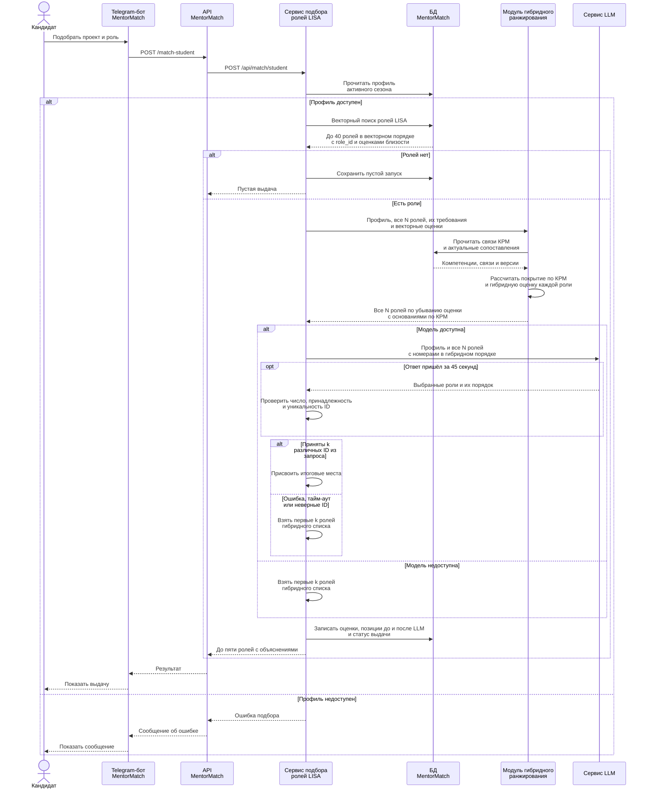

# ЛР 3 — Проектирование информационной системы

**Тема ВКР:** «Разработка модуля подбора проектных ролей для кандидата на основе графа компетенций при неполных данных профиля».

**Цель лабораторной работы:** сформулировать требования к модулю, спроектировать процессы, данные и взаимодействия, показать переход от исходного способа подбора к предлагаемому.

## 1. Предметная область и основа проектирования

Кандидат заполняет действующую студенческую анкету в Google Forms. В ней он описывает свой опыт, указывает навыки, интересы и то, чему хочет научиться. MentorMatch импортирует ответы в профиль кандидата. Модуль самостоятельно связывает сведения профиля с компетенциями КРМ и сопоставляет их с требованиями проектных ролей. Заявленные кандидатом навыки принимаются как достоверные.

В разделе «Проекты LISA» Telegram-бота MentorMatch кандидат нажимает «Подобрать проект и роль». Сервис находит до 40 ролей активного сезона по векторной близости к профилю. В предлагаемом методе модуль рассчитывает покрытие требований каждой роли по КРМ, объединяет его с векторной близостью и сортирует весь найденный список. LLM получает роли в этом порядке и выбирает до пяти для показа кандидату. Единица рекомендации — роль с собственным `role_id`, в том числе когда у одного проекта несколько ролей.

Основа проектирования — исследования 1 и 3 из отчёта к ЛР 2.

| Исследование                                                                                                                                                           | Используемая идея                                                                                        | Адаптация для ВКР                                                                                                                                            |
| ---------------------------------------------------------------------------------------------------------------------------------------------------------------------- | -------------------------------------------------------------------------------------------------------- | ------------------------------------------------------------------------------------------------------------------------------------------------------------ |
| [Skills2Job](https://www.researchgate.net/publication/363409945_Skills2Job_A_Recommender_System_that_Encodes_Job_Offer_Embeddings_on_Graph_Databases_Student_Abstract) | Рекомендации по навыкам с использованием семантических представлений, значимости навыков и графовой базы | Связи навыков с требованиями конкретной роли LISA через КРМ. Значимость совпадений проверяется по экспертной оценке итоговой выдачи |
| [Towards Explainable Job Title Matching](https://ceur-ws.org/Vol-4046/RecSysHR2025-paper_8.pdf)                                                                        | Объединение текстовых представлений и графа знаний, анализ качества по группам примеров                  | Семантическая близость профиля и роли дополняется графовыми соответствиями. Качество анализируется отдельно для разных уровней полноты профиля               |

**Гипотеза исследования.** При неполной анкете гибридная оценка по векторной близости и покрытию требований по КРМ ставит более подходящие роли в первую пятёрку ещё до обращения к LLM. Ожидается, что преимущество по экспертной nDCG@5 сохранится и в итоговой выдаче по сравнению с действующим подбором LISA на тех же ролях. Отдельно проверяется, чаще ли LLM сохраняет состав предварительной пятёрки и чаще ли оставляет все пять ролей на своих местах.

## 2. Требования к системе

### Функциональные требования

N — число найденных ролей для одного запроса кандидата (`0 ≤ N ≤ 40`), `k = min(5, N)` — число ролей в целевой выдаче.

| Код | Требование | Критерий проверки |
| --- | --- | --- |
| Ф1 | Получать актуальный профиль кандидата из действующей студенческой анкеты с учётом ручных правок | Команда «Подобрать проект и роль» использует профиль допущенного студента активного сезона |
| Ф2 | Использовать результаты действующего векторного поиска по ролям LISA | Для всех N уникальных `role_id` доступны `topic_id`, исходная позиция и векторная близость. Две роли одного проекта сохраняют разные идентификаторы |
| Ф3 | Связывать заявленные навыки, опыт кандидата и требования ролей с компетенциями КРМ | Для каждого установленного соответствия доступны исходное поле, фрагмент текста и версия КРМ |
| Ф4 | Различать заявленное владение, цели обучения и требования без достаточных сведений | Фраза «хочу освоить SQL» учитывается как пожелание. Владение SQL при отсутствии других сведений остаётся неизвестным |
| Ф5 | Упорядочивать все найденные роли по векторной близости и покрытию требований по КРМ | Каждая из N ролей получает гибридную оценку и место по убыванию этой оценки. При равенстве сохраняется порядок векторного поиска. Для каждой роли видны покрытые требования и требования без достаточных сведений |
| Ф6 | Передавать в LLM весь гибридный список для выбора итоговых ролей | При N > 0 и доступной LLM порядок всех N идентификаторов в запросе совпадает с гибридным. Ответ содержит `k` различных `role_id` из любой части списка. При N = 0 вызов пропускается |
| Ф7 | Объяснять итоговые рекомендации через требования, навыки и пожелания | Карточка роли показывает, какие фразы анкеты связаны с её требованиями, где совпала цель обучения и по каким требованиям сведений недостаточно |
| Ф8 | Учитывать изменения анкеты и требований роли при следующем запуске | Изменённый фрагмент попадает в новое сопоставление. Основания прежней рекомендации доступны по снимку соответствующего запуска |
| Ф9 | Сравнивать действующий и предлагаемый методы до и после LLM | По одному запуску восстанавливаются векторный порядок, гибридный порядок для TO-BE, фактически переданный список, итоговые места и статус LLM. Можно проверить состав и порядок пятёрки по `role_id` |

### Нефункциональные требования

| Код | Требование | Критерий проверки |
| --- | --- | --- |
| Н1 | Разграничение доступа и минимизация персональных данных | Подбор использует разрешённый профиль и доступные проекты. Во внешнюю LLM в целевом варианте передаются относящиеся к задаче сведения без имени и контактов |
| Н2 | Ограничение вычислительных затрат | Поиск возвращает не более 40 ролей. Гибридная сортировка охватывает все N. Для непустого набора при доступной LLM в запрос входят все N. Для каждого этапа регистрируются время и доступные сведения о расходе токенов |
| Н3 | Устойчивость к отказу LLM | При недоступности LLM, превышении тайм-аута в 45 секунд или некорректном ответе сервис выдаёт первые `k` ролей уже рассчитанного гибридного списка и сохраняет причину резервной выдачи |
| Н4 | Воспроизводимость эксперимента | Снимок содержит видимый профиль, оценки и позиции ролей на каждом этапе, версию требований, КРМ и метода, вес покрытия, модель, промпт, настройки генерации и статус выдачи |
| Н5 | Целостность и прослеживаемость данных | Совпадение ведёт к конкретному требованию роли и фрагменту профиля. Статус «сведений нет» допускает отсутствие такого фрагмента |
| Н6 | Совместимость с MentorMatch | Переиспользуются существующие идентификаторы кандидата, проекта и роли. При недоступности графового модуля действующий подбор по тем же ролям доступен отдельно |

## 3. Краткий обзор нотаций и видов диаграмм

| Нотация или вид диаграммы | Что описывает | Сильная сторона |
| --- | --- | --- |
| BPMN | Бизнес-процессы, участников, события и сообщения | Показывает ответственность участников, развилки и исключения |
| IDEF0 | Функции, входы, выходы, управление и механизмы | Удобна для определения границ системы и декомпозиции функций |
| IDEF3 | Последовательности выполнения работ и сценарии | Позволяет описать альтернативные пути выполнения процесса |
| ER-модель | Сущности, атрибуты, связи и их кратности | Позволяет проверить структуру хранения и целостность данных |
| DFD | Потоки данных между процессами, хранилищами и внешними сущностями | Наглядно показывает происхождение и преобразование информации |
| UML — диаграмма вариантов использования | Функции системы с точки зрения акторов | Помогает определить границы системы и права участников |
| UML — диаграмма активности | Действия, условия переходов и ветвления | Подходит для проверки бизнес-логики и сравнения AS-IS/TO-BE |
| UML — диаграмма последовательностей | Обмен сообщениями между участниками во времени | Показывает порядок вызовов, проверки доступа и обработку отказов |
| UML — диаграмма компонентов | Программные компоненты и зависимости | Позволяет распределить ответственность между модулями |
| C4 | Контекст, контейнеры, компоненты и детали реализации | Даёт согласованные представления архитектуры разного масштаба |

## 4. Выбор нотаций

Выбраны четыре вида диаграмм: UML-диаграмма компонентов, UML-диаграмма активности, ER-диаграмма и UML-диаграмма последовательностей. Для AS-IS и TO-BE используются две отдельные диаграммы активности. Диаграммы представлены средствами Mermaid; компоненты и активности показаны в упрощённой графической записи UML.

| Модель | Почему выбрана для ВКР | Проверяемые требования |
| --- | --- | --- |
| UML-диаграмма компонентов | Определяет границу нового модуля внутри MentorMatch, распределяет ответственность и показывает зависимости от основного приложения и LLM | Ф1–Ф7, Ф9, Н1–Н3, Н6 |
| UML-диаграмма активности | Показывает путь от запроса в Telegram-боте до выдачи ролей и позволяет сравнить обработку одного и того же профиля в AS-IS и TO-BE | Ф1–Ф8, Н3 |
| ER-диаграмма | Связывает актуальный профиль, исходный фрагмент, компетенцию и требование роли. Выделяет существующие таблицы и проектируемое расширение | Ф1–Ф4, Ф7–Ф9, Н4–Н5 |
| UML-диаграмма последовательностей | Показывает обработку запроса из Telegram, чтение профиля, сопоставление с КРМ и ответ при отказе LLM | Ф1–Ф9, Н1–Н4, Н6 |

Диаграмма компонентов показывает, где новый модуль объединяет векторную близость с покрытием требований по КРМ. Диаграммы активности сопоставляют два порядка подачи одних и тех же ролей в LLM. ER-диаграмма показывает, какие оценки и места сохраняются, а диаграмма последовательностей — когда сервис передаёт упорядоченный список и принимает итоговые роли.

### 4.1. Диаграмма компонентов

Входом служит действующая команда Telegram-бота. Основной API передаёт запрос сервису подбора. После штатного поиска расширение получает исходные позиции и векторную близость всех найденных ролей. Графовый модуль рассчитывает покрытие требований, а компонент гибридной сортировки задаёт порядок передачи ролей в LLM.

Сервис подбора сохраняет привычный ответ для Telegram-бота. В TO-BE адаптер запроса `rank_roles` получает весь гибридный список, нумерует роли в порядке отправки и добавляет к каждой покрытие, совпадения по владению, цели обучения и требования без сведений. Ответ привязывается к `role_id` по тому же списку. Для объяснения рекомендации модуль извлекает сохранённые фразы анкеты и требования роли.

## 5. Проектирование данных

Единица оценки — пара «кандидат — роль проекта». Проект определяется по `topic_id`, роль внутри него — по `role_id`. Две роли одного проекта могут иметь разные требования и разные итоговые места.

### 5.1. Существующие данные MentorMatch

| Данные | Существующее представление | Использование в подборе LISA |
| --- | --- | --- |
| Кандидат | `users`, `student_season_profiles` | Идентификатор, статус допуска и вектор студента находятся в `users`. Сезонный профиль подтверждает участие в активном сезоне |
| Анкета и ручные правки | `student_form_responses`, `student_source_profiles`, `student_profile_overrides`, функция `student_effective_profile` | Сервис получает актуальные поля прежней анкеты, в том числе описание опыта, `skills`, `skills_to_learn` и интересы. Словарь `SKILLS` используется для распознавания известных обозначений |
| Проект | Таблица `topics`, представление `topic_catalog` | У проекта есть автор, сезон, описание, ожидаемые результаты и общие требования. Для поиска используются карточки с `opportunity_kind = 'lisa'`, предназначенные для студентов |
| Роль проекта | `roles`, внешний ключ `roles.topic_id → topics.id` | У роли есть собственный `id`, описание, `required_skills`, вектор и обозначение `krm_role`. Требования роли и общие требования проекта можно отличить по полю-источнику |
| Сохранённые рекомендации | `student_candidates`, ключ `(user_id, role_id)` | Сервис обновляет позицию роли, признак первого места и `score = 6 − rank`. Этот балл кодирует место в выдаче. Векторная близость рассчитывается на этапе поиска |

Для восстановления полного набора ролей на момент подбора нужны входные данные конкретного запуска. Запись в `student_candidates` обновляется для пары «кандидат — роль» и сама по себе содержит только сведения о выданной рекомендации.

### 5.2. Новые сущности расширения

| Проектируемая сущность | Что хранит и для чего используется |
| --- | --- |
| `NEW_PROFILE_MAPPING` | Сопоставление конкретного состояния профиля с КРМ. Фиксируются кандидат, сезон, хеш и снимок входа, версии КРМ и метода |
| `NEW_CANDIDATE_COMPETENCY` | Поле и фрагмент профиля, компетенция, тип высказывания (владение или цель обучения), состояние сопоставления и уровень, если он указан |
| `NEW_COMPETENCY`, `NEW_COMPETENCY_LINK` | У компетенции есть система КРМ, версия и код. У каждой типизированной связи между компетенциями сохраняется основание |
| `NEW_ROLE_REQUIREMENT` | Требование, применимое к конкретному `roles.id`. Хранятся его ключ, поле и фрагмент описания роли или проекта, связь с КРМ, состояние этой связи и хеш исходных требований. Обязательность и уровень фиксируются, когда они указаны в источнике |
| `NEW_MATCH_RUN` | Снимок запуска действующего или предлагаемого метода. Хранит видимый профиль, метод, настройки гибридной оценки (включая вес покрытия), версии модели и промпта, параметры генерации, статус реранкинга, время и сведения о токенах |
| `NEW_RUN_ROLE` | Одна запись на найденный `role_id`. Содержит исходную позицию и векторную близость, снимок требований, основания и числа для расчёта покрытия. Для TO-BE добавляются гибридная оценка и место. Отдельно хранятся фактическая позиция в запросе к LLM и итоговое место выданной роли |

Обозначение `roles.krm_role` помогает выбрать справочный контекст. Основанием конкретного требования служит формулировка в карточке роли или применимое к ней требование проекта. При повторении одного требования в двух полях оно учитывается один раз, а оба фрагмента можно сохранить как его источники.

### 5.3. ER-диаграмма расширения

Имена в нижнем регистре обозначают существующие таблицы. Префикс `NEW_` выделяет проектируемые сущности. Каталог `topic_catalog` — представление над проектами, поэтому внешний ключ роли на схеме ведёт к таблице `topics`.

### 5.4. Правила хранения и интеграции

- **Сведения кандидата.** Заявленным навыкам и опыту доверяют по умолчанию. Исходное поле и фрагмент показывают, сообщил ли кандидат о применении навыка или о желании его освоить. По неуказанному навыку владение остаётся неизвестным.
- **Уровень и неоднозначность.** Фраза о применении навыка подтверждает заявленный опыт. Если требуемый уровень нельзя установить или фраза допускает несколько трактовок, основание сохраняется с соответствующей пометкой.
- **Актуальность.** После импорта изменённой анкеты или ручной правки обрабатывается новое состояние профиля. При изменении текста роли или общих требований проекта обновляются сопоставления затронутых ролей. Версии КРМ и метода позволяют воспроизвести прежнюю интерпретацию.
- **Позиции роли в запуске.** В `NEW_RUN_ROLE` пара «запуск — роль» уникальна. `input_rank` задаёт место в векторном поиске. В TO-BE `hybrid_score` и `hybrid_rank` хранят оценку и место после гибридной сортировки. `llm_input_rank` фиксирует фактическое место роли в отправленном запросе. Для базового метода оно совпадает с `input_rank`, для гибридного — с `hybrid_rank`. Если вызова не было, поле пусто. `output_rank` заполняется только для выданных ролей. В запуске ровно N записей, а итоговые места от 1 до `k` уникальны. Снимок сохраняет эти позиции после изменений профиля или роли. По статусу запуска различаются ответ LLM и резервная выдача.

## 6. Гибридное ранжирование всех найденных ролей

1. **Получить векторную близость.** Сохраняем `role_id` и позицию каждой роли в результате штатного поиска. Его поле `score` равно единице минус косинусное расстояние и записывается в снимок как `vector_score`. Для объединения с покрытием переводим её в шкалу от 0 до 1 по формуле `V = (1 + vector_score) / 2`.
2. **Оценить покрытие требований по КРМ.** Для каждой роли `t` — число различных применимых требований роли и проекта, `m` — число требований, для которых связь через КРМ ведёт к заявленному навыку или опыту кандидата. Если требование задаёт уровень, совпадение засчитывается, когда заявленный опыт указывает на достижение этого уровня. Каждое требование даёт не более одного совпадения. Покрытие `C = m / t` показывает, для какой доли требований есть основания в анкете. Цель обучения сохраняется как пожелание. По неуказанному навыку, неоднозначной связи или неизвестному уровню владение остаётся неизвестным, и требование не увеличивает `m`. При `t = 0` покрытие не определено.
3. **Упорядочить весь список.** `H = V + λ × C`. Вес `λ` в диапазоне от 0 до 1 выбирается по экспертной nDCG@5 **до LLM** на отдельных кандидатах и фиксируется до теста. При `λ = 0` получается векторный порядок. При `t = 0` роль получает `H = V`. Все N ролей сортируются по убыванию `H`, а при равенстве сохраняют исходный порядок поиска. Первые `k` образуют предварительную выдачу метода, с которой затем сравнивается ответ LLM. Роли с неизвестным владением также участвуют в сортировке и передаются в LLM.
4. **Передать все роли и проверить ответ.** При N > 0 и доступной модели сервис нумерует роли после сортировки и передаёт в LLM все N в гибридном порядке вместе с основаниями по КРМ. Модель выбирает и упорядочивает `k` ролей из всего списка. Сервис сверяет число, принадлежность и уникальность `role_id`, а ссылку на номер сопоставляет с позицией в фактически отправленном списке. При отказе LLM выдаются первые `k` ролей гибридного списка. При N = 0 сервис возвращает пустую выдачу без обращения к модели.

**Пример.** Кандидат пишет «Автоматизировал отчёты на Python» и «Хочу освоить SQL». Если для роли нужны Python и SQL, покрыто одно требование из двух (`C = 0,5`). По SQL есть цель обучения, а владение пока неизвестно. Пусть у этой роли `V = 0,75`, а у другой `V = 0,80` и ни по одному из её требований нет сведений (`C = 0`). При иллюстративном `λ = 0,2` оценки составят `0,85` и `0,80`. Первая роль поднимется выше второй. Обе останутся доступны LLM, даже если одна из них окажется за пределами первых пяти.

## 7. Процесс AS-IS / TO-BE

На обеих схемах рассматривается один запрос кандидата из раздела «Проекты LISA» Telegram-бота MentorMatch. **И1** обозначает представление сведений о кандидате и роли, **И2** — порядок подачи всех ролей в LLM и выбор пятёрки, **И3** — объяснение и сохранение результата.

### AS-IS — действующий подбор проектных ролей LISA

| Этап | Что делает текущая реализация |
| --- | --- |
| Запрос и профиль | Бот отправляет `POST /match-student` в основной API, который вызывает `POST /api/match/student` сервиса подбора. `fetch_student` читает эффективный профиль допущенного студента за активный сезон |
| Поиск ролей | `fetch_roles_needing_students` выбирает роли с векторами у проектов этого сезона с признаками `opportunity_kind = 'lisa'` и `seeking_role = 'student'`. Исключаются служебная роль и отозванный источник. Результаты сортируются по косинусному расстоянию до вектора студента. В список входят до 40 отдельных ролей. Несколько ролей одного проекта сохраняются |
| Данные для модели (И1) | `build_roles_for_student_payload` нумерует роли, а `rank_roles` формирует запрос. В тексте запроса есть имя, направление, навыки, желаемые навыки и интересы студента, описания и требования ролей и проектов. Векторный порядок задаёт последовательность вариантов |
| Итоговая выдача (И2) | LLM предлагается вернуть ровно пять элементов из входного списка. Сервис ищет роль по `role_id`, при необходимости — по её исходному номеру. Элементы, для которых роль найти не удалось, пропускаются. При отсутствии клиента или пригодного для разбора ответа используются `roles[:5]`. При пустом поиске сервис возвращает `items = []` сразу |
| Сохранение и показ (И3) | Для выданных ролей сервис записывает в `student_candidates` место, признак первого места и балл `6 − rank`. Telegram-бот выводит название роли, проект и переданный сервисом текст причины |

Число 40 ограничивает вход действующего поиска. В штатном сценарии модель сразу выбирает пятёрку из найденных ролей. Например, две роли в одном проекте могут обе попасть в рекомендации, если соответствуют разным сторонам опыта кандидата.

### TO-BE — гибридный порядок всех ролей и выбор итоговой пятёрки

Серым показаны существующие шаги, зелёным — добавленные расчёт покрытия и гибридная сортировка, синим — изменившиеся шаги. Метки И1–И3 позволяют сопоставить схемы при чёрно-белой печати.

В И1 у каждой роли появляются проверяемые связи между фразами анкеты и её требованиями. В И2 действующий сервис отправляет роли по векторной близости, а предлагаемый — по гибридной оценке. У обоих методов один и тот же набор `role_id`. В И3 кандидат видит основания рекомендации, а исследователь может установить, какие роли сохранили места, поменялись местами или вошли в пятёрку после LLM. Частоты этих событий и качество выдачи проверяются в пункте 9.

## 8. Взаимодействие компонентов

В запросе TO-BE `num` соответствует гибридной позиции. Сервис сохраняет фактически отправленный порядок даже при ошибке ответа. Повторный запрос после изменения анкеты использует новый эффективный профиль. Если весь графовый модуль недоступен, сервис может выполнить штатный векторный сценарий LISA и отметить этот режим отдельно от гибридного подбора.

## 9. Проверка согласованности и оценка улучшений

### 9.1. Проверка требований

| Требования | Сценарий проверки | Ожидаемый результат |
| --- | --- | --- |
| Ф1–Ф4, Н1, Н5 | Взять доступный профиль с опытом Python и целью освоить SQL. Запросить также недоступный профиль | В первом случае есть связь с опытом Python, цель по SQL и исходные фразы. Во втором случае сервис возвращает ошибку доступа к профилю |
| Ф2, Ф5 | Проверить N = 0, 1, 4, 5, 6, 27 и 40, а также поиск в каталоге более чем из 40 ролей. Включить две роли одного проекта, равные гибридные оценки и роль без описанных требований | До и после сортировки множество `role_id` совпадает. Оценки упорядочены по убыванию, при равенстве сохраняется исходная позиция. Роль без требований остаётся в списке с оценкой по векторной близости |
| Ф6, Н2–Н3 | Сверить фактический запрос с гибридным списком. При N = 6 вернуть шестую роль в пятёрке. Проверить также короткий список, пустой поиск, тайм-аут, дубликат и посторонний ID | Отправлены все N ролей в гибридном порядке. Корректный ответ принят, в том числе с шестой ролью. При сбое выдаются первые `k` гибридных ролей с отметкой о причине. При N = 0 вызова нет |
| Ф7–Ф9, Н4 | Проследить объяснение до поля анкеты, изменить профиль или требования и повторить запрос. Сопоставить снимок прежнего запуска с его запросом и ответом | Новый запуск использует обновлённые сведения. По прежнему снимку восстанавливаются обе оценки, порядок отправки, итоговые места и результат проверки сохранения пятёрки |
| Н1, Н6 | Проверить текст для внешней LLM и запрос при недоступном графовом модуле | В целевом запросе передаются нужные для подбора обезличенные данные. При отказе графового модуля доступен штатный сценарий LISA с отметкой о режиме запуска |

### 9.2. Изменения, показанные на схемах

| Точка | AS-IS | TO-BE | Как проверить |
| --- | --- | --- | --- |
| И1 — сведения о соответствии | Модель получает тексты анкеты, проектов и ролей | Для каждого `role_id` отдельно представлены владение, пожелания и требования без сведений, со ссылками на исходные фразы | Эксперт проверяет корректность связи и тип высказывания |
| И2 — порядок и итоговая пятёрка | Все N ролей поступают в LLM по векторной близости | Те же N ролей поступают по гибридной оценке вместе с графовыми основаниями. LLM выбирает из всего списка | Сравнить nDCG@5 и Precision@5 до и после LLM. Посчитать, как часто сохранены состав и точный порядок входной пятёрки (§ 9.4) |
| И3 — объяснение и история | В выдаче есть текст причины, в `student_candidates` сохраняется позиция рекомендованной роли | Для конкретного запуска можно восстановить весь вход и объяснить выданную роль по цепочке «фрагмент анкеты → компетенция КРМ → требование роли» | Доля объяснений с корректным основанием и число случаев, когда цель обучения ошибочно засчитана как владение |

### 9.3. Эксперимент с предварительной и итоговой пятёрками

1. **Зафиксировать набор ролей и экспертный эталон.** Для каждого кандидата сохранить до 40 ролей, найденных штатным поиском в одном сезоне, их `role_id`, тексты и исходные позиции. Эксперты оценивают каждую пару «кандидат — роль» по полному профилю, не видя выдач методов. Оценка 0 означает неподходящую роль, 1 — подходящую, 2 — хорошо подходящую. Один эталон действует при всех уровнях скрытия сведений.
2. **Подготовить неполные профили.** Для настройки веса `λ` и для теста использовать разные группы кандидатов. На тесте скрыть 0, 25, 50 и 75 % известных сведений о владении, удаляя все упоминания, раскрывающие соответствующий навык. Для каждой маски заново построить вектор видимого профиля и сопоставления с КРМ. Обоим методам дать один видимый профиль и одинаковые N ролей. Векторные оценки пересчитать внутри этого зафиксированного набора.
3. **Выполнить парные прогоны.** Сначала измерить исходные показатели действующего LISA. Базовый метод отправляет в LLM все N ролей в векторном порядке. Гибридный отправляет те же роли в порядке `H` с основаниями по КРМ. Для каждого метода сохранить порядок фактического запроса и порядок ответа. Использовать одинаковые версию модели, параметры генерации, число повторов и правила обезличивания. Чтобы отдельно оценить влияние порядка подачи, выполнить контрольный прогон с теми же графовыми сведениями и инструкцией, что в гибридном варианте, но в векторном порядке. При фиксированном порядке ещё один контроль с теми же фрагментами в виде обычного текста позволяет оценить вклад явных связей с КРМ.
4. **Измерить пригодность ролей.** Для каждого метода рассчитать nDCG@5 и Precision@5 дважды — для первых `k` ролей до LLM и для итоговой выдачи. Идеальный порядок для nDCG@5 строится по оценкам всех N ролей. В Precision@5 число различных ролей с оценкой 1 или 2 делится на 5. При N < 5 незаполненные места дают нулевой вклад. Если все оценки равны нулю, nDCG@5 не определена. Пустые наборы учитывать отдельно.
5. **Сопоставить результаты.** По каждому кандидату и уровню скрытия усреднить повторы, затем показать число кандидатов, среднюю парную разность метрик между методами и её разброс. Для неполных профилей проверить преимущество гибридного метода до и после LLM. Полные профили служат контролем. Отдельно привести частоту отказов, качество резервной выдачи, время этапов и расход токенов.

### 9.4. Как часто LLM сохраняет пятёрку

Для каждого успешного вызова с `N > 5` взять два упорядоченных списка `role_id` из одного запуска. **До LLM** — первые пять ролей фактически отправленного списка (векторного у базового метода, гибридного у предлагаемого). **После LLM** — пять различных ролей, которые вернула модель. Нужны обе последовательности. По одной итоговой записи в `student_candidates` исходную пятёрку восстановить нельзя.

| Показатель | Когда засчитывается совпадение | Что приводится в отчёте |
| --- | --- | --- |
| Сохранение состава | До и после LLM в пятёрке ровно те же пять `role_id` в любом порядке | Число совпадений `S` из `M` запусков и `100 × S / M` % |
| Полное сохранение порядка | В каждой из пяти позиций после LLM стоит тот же `role_id`, что до неё | Число совпадений `P` из тех же `M` запусков и `100 × P / M` % |
| Число замен в пятёрке | Для одного запуска равно 5 минус число общих `role_id` двух пятёрок | Среднее число замен и распределение от 0 до 5 |

Например, переход `[A, B, C, D, E] → [B, A, C, D, E]` сохраняет состав, меняет порядок и даёт ноль замен. При переходе к `[A, B, C, D, F]` меняются и состав, и порядок, замена одна. Поэтому `P` входит в `S`, а `S − P` показывает, сколько раз модель только переставила роли внутри пятёрки.

Для каждого метода и уровня скрытия `M` — число запусков с `N > 5`, для которых сохранены запрос и корректный ответ LLM. Для прямого сравнения обоим методам пересчитывают частоты на общих успешных парах. При `M = 0` частота не определена. Запуски с N = 5 показываются отдельной строкой — состав неизбежно сохранён, а порядок всё ещё может измениться. Для общей частоты по всем полным пятёркам складывают числители и знаменатели групп N = 5 и N > 5. Короткие списки (N < 5), резервные ответы и прогоны без сохранённой пары «вход — ответ» подсчитываются отдельно. Рост частоты совпадений интерпретируется вместе с экспертными метриками из § 9.3, поскольку модель может сохранить и слабо подходящую пятёрку.

## 10. Выводы

Спроектировано расширение действующего подбора проектных ролей LISA. Кандидат заполняет прежнюю анкету. Штатный поиск находит до 40 ролей, а новый модуль объединяет векторную близость и покрытие требований по КРМ в оценку каждой роли. Все найденные роли поступают в LLM по убыванию этой оценки. Из Skills2Job использована идея связи навыков с профессиональными требованиями, из работы о сопоставлении должностей — сочетание графовых и текстовых признаков и анализ качества при разной полноте данных.

Улучшения процесса обозначены одинаковыми метками на схемах AS-IS и TO-BE.

- **И1.** Для каждой роли видно, какие требования покрываются заявленным опытом и какие совпадают с целями обучения кандидата.
- **И2.** До вызова LLM модуль формирует собственную предварительную пятёрку. Например, при 27 найденных ролях в запрос входят все 27. Модель может изменить порядок первых пяти или включить роль с шестого места и ниже.
- **И3.** Объяснение в Telegram-боте опирается на исходную фразу анкеты и требование проекта. Снимок запуска позволяет проверить основание рекомендации после изменения данных.

**Критерий улучшения.** На одинаковых наборах ролей экспертная nDCG@5 показывает, улучшился ли порядок до LLM и сохранилось ли преимущество в итоговой выдаче. Precision@5 показывает долю подходящих ролей. Две отдельные частоты показывают, в какой доле запусков LLM сохранила состав предварительной пятёрки и в какой доле совпали все пять позиций.

